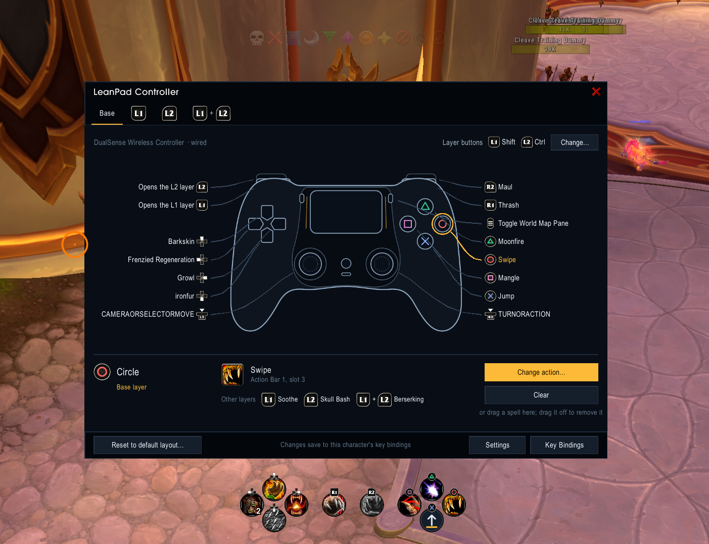
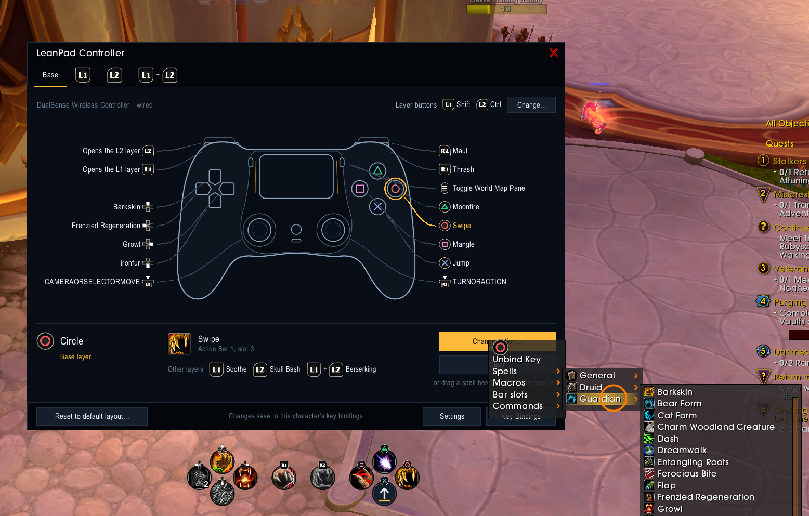
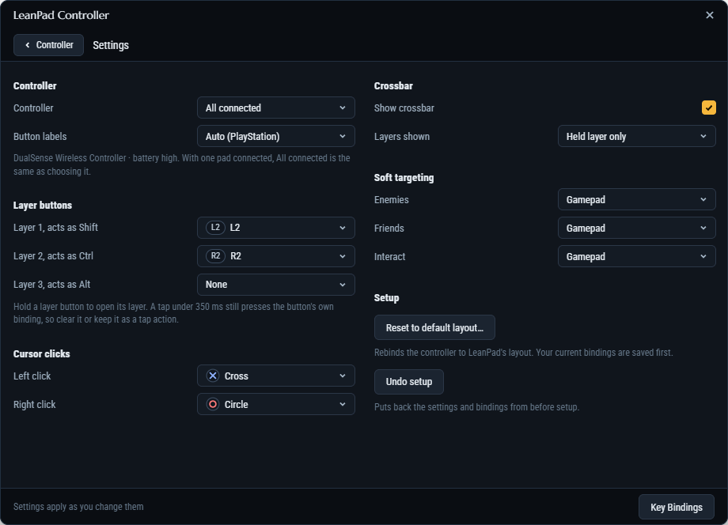
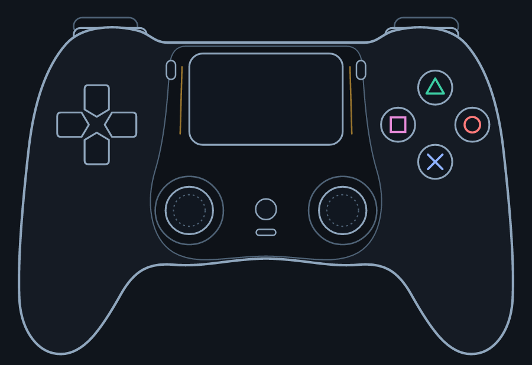
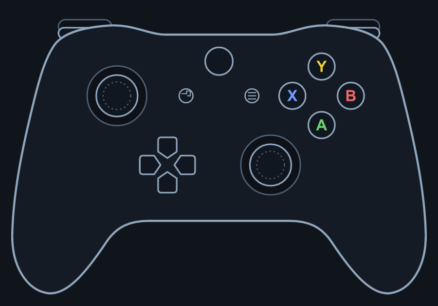

<p align="center"></p>

# LeanPad

A lean controller addon for retail World of Warcraft (Midnight, 12.1.5).

WoW already has a full gamepad layer built in: controller buttons are ordinary key bindings, the triggers can act as Shift and Ctrl, and there is a native gamepad cursor and soft targeting. LeanPad configures that layer for you instead of rebuilding it. You get a one-click setup, a crossbar-style layout across three trigger layers, a visual controller editor with its own settings page, and a movable crossbar HUD. It has no libraries and no code running while you are idle; its only art is its own controller drawings and command icons.

Your actions stay on Blizzard's own action bars, so Blizzard draws the cooldowns, glows and range, and the layout keeps working if you disable the addon.

**Easy binding setup.** Press a button on your pad and see what it does on every layer, then change it in one step.



**Easy binding mapping.** Pick a spell or macro straight from your spellbook, by spec, and LeanPad puts it on the button for you.



**Easy to understand settings.** Layer buttons, pad, labels, cursor, crossbar and soft targeting on one page next to the editor.



## Features

- **One-click setup.** Turns on the gamepad, makes LT and RT act as Shift and Ctrl, sets the cursor clicks and gamepad soft targeting, and binds the controller to Action Bars 1-4. If you already have a controller layout, LeanPad keeps it by default.
- **Undo.** Setup and every reset save your controller settings and bindings first. *Undo reset* (`/lp undo`) brings back the layout the last reset replaced; *Undo setup* (`/lp restore`) returns to how things were before LeanPad.
- **Three crossbar layers.** LT, RT and LT+RT each map the D-pad and face buttons onto 8 slots of their own action bar. The layer buttons only open layers and fire nothing themselves, as in FFXIV.
- **Controller editor.** `/lp` shows a drawing of your controller (PlayStation or Xbox, detected from the pad) with every bound button labelled around it, one layer at a time. Press any button, holding a layer button first for its layer, and LeanPad shows what it does: the spell on the slot, where it lives and what the same button does on the other layers. From there, pick a spell or macro straight from the menu and LeanPad finds it a bar slot, pick a bar slot or command by hand, clear it, or drag a spell onto it. Cursor users can click the drawing instead. The Menu button closes the editor.
- **Settings page.** The editor's Settings button opens LeanPad's own page: which pad to use, Xbox or PlayStation labels, the layer buttons, a play style per role or by spec, soft targeting, the crossbar's view, size, opacity and position, and the native cursor's clicks, speed and behaviour.
- **Profiles.** Save your whole setup, settings, bindings, controller CVars and the bar slots your pad fires, as a profile such as Tank, DPS or Healer, and switch from the settings page's *Profile* menu or `/lp profile <name>`. Link a spec to a profile and LeanPad switches when you change spec. Profiles are shared by all your characters; each remembers its own.
- **Play styles.** Tank keeps the body facing the camera in combat, so you never show the pack your back. Melee and Ranged strafe but spin to run when you push straight back. Healer runs free, since heals need no facing, and gets friendly soft targeting. Auto follows your spec.
- **Crossbar HUD.** Shows your controller actions in controller-shaped clusters, with cooldowns, charges, usability, range, proc glows and a blink on every press. Seven styles: the D-pad and face-button clusters, as one set that swaps as you hold a layer button or all layers at once; one row, ordered by hand, which can stay faint until a layer is held; a square grid under the character; and a row per layer, square or round. Unlock it from the settings page or Blizzard's Edit Mode to drag the bar, each set or each button, with grid and neighbour snapping, and scroll over a set to size it. Turn its mouse on to click sockets as you would action bar buttons, drop spells onto them and read their tooltips.
- **Blizzard's Settings panel.** *AddOns > LeanPad* opens the editor and its settings page, runs setup and undoes it.
- **Icons for every command.** Targeting, interact, jump, bags, menus and the rest have faces of their own, so the crossbar and the editor never show a blank socket for a command that lives on no action bar.

  

- **Combat-safe.** Bindings and CVars are only written out of combat. A request made in combat runs once combat ends.

## Requirements

- World of Warcraft retail, interface 120105 (12.1.5)
- A controller that WoW's built-in gamepad support recognises

## Installation

1. Download the latest release, or clone this repository.
2. Copy the `LeanPad` folder (the one containing `LeanPad.toc`) into `World of Warcraft\_retail_\Interface\AddOns\`.
3. Start the game, or type `/reload` if it is already running.

On your first login, LeanPad asks whether to set up the controller. You can run setup again any time from the editor's settings page or *Settings > AddOns > LeanPad*. LeanPad is also listed in the minimap's addon compartment.

> **Using ConsolePort?** Disable it before using LeanPad. Both addons manage the gamepad bindings and CVars, and they will overwrite each other.

## Usage

| Command | What it does |
| --- | --- |
| `/lp` or `/leanpad` | Open or close the controller editor |
| `/lp settings` | Open the editor on its settings page |
| `/lp profile <name>` | Switch to a profile |
| `/lp undo` | Bring back the controller layout from before the last reset |
| `/lp restore` | Restore the controller settings and bindings from before setup |
| `/lp perf` | Print LeanPad's CPU cost from the in-game addon profiler |

LeanPad also adds a **Toggle gamepad cursor** binding under *Key Bindings > AddOns > LeanPad*.

### Changing a button

1. Open the editor with `/lp`. Hold a layer button first to work on that layer.
2. Press the button you want to change. The strip under the drawing shows what it does now and on the other layers.
3. Choose **Change action**. *Spells* and *Macros* list your spellbook and macros; pick one and LeanPad puts it on the button, finding a free slot on that layer's action bar if the button has none. *Bar slots* and *Commands* list everything else Blizzard can bind. You can also drag a spell from the spellbook onto the strip.

Each change is saved straight away to your account's or character's key bindings, whichever WoW is using, and the footer says *Saved*.

### Default layout

Button names use Xbox labels.

| Button | Action |
| --- | --- |
| A | Jump |
| B | Interact with target |
| X, Y | Action Bar 1, slots 1-2 |
| LB, RB | Action Bar 1, slots 3-4 |
| D-pad up, down | Action Bar 1, slots 5-6 |
| D-pad left, right | Previous enemy, nearest enemy |
| Left stick click | Auto-run |
| Right stick click | Toggle the gamepad cursor |
| View | Open bags (LT+View: world map, RT+View: character) |
| Menu | Game menu (LT+Menu: spellbook) |

| Hold | Uses | D-pad up, right, down, left | Y, B, A, X |
| --- | --- | --- | --- |
| LT | Action Bar 2 | slots 1-4 | slots 5-8 |
| RT | Action Bar 3 | slots 1-4 | slots 5-8 |
| LT+RT | Action Bar 4 | slots 1-4 | slots 5-8 |

Click the right stick to bring up the gamepad cursor when you need to click on an NPC, object or window; A then left-clicks and B right-clicks. Click it again to hide the cursor.

To see a layer on screen, turn on Action Bars 2-4 in *Settings > Action Bars* and place them in Edit Mode, or use LeanPad's crossbar HUD.

## Development

```sh
docker build -t leanpad-test spec
docker run --rm -v "${PWD}:/src" leanpad-test
```

The tests run [busted](https://lunarmodules.github.io/busted/) on Lua 5.1, the version the WoW client embeds. The run fails if line coverage of `LeanPad/` drops below 100%. `spec/wow.lua` fakes the WoW API, so every new API the addon calls needs a stub there.

For live testing, link the `LeanPad` folder into your `AddOns` folder and use `/reload` after each edit. On Windows:

```powershell
New-Item -ItemType Junction -Path "<WoW>\_retail_\Interface\AddOns\LeanPad" -Target "<repo>\LeanPad"
```

Ground rules for changes:

- Check every API against the `live` branch of [Gethe/wow-ui-source](https://github.com/Gethe/wow-ui-source).
- Only write CVars and bindings out of combat, from code the player triggered.
- Never compare or do arithmetic on combat values; in Midnight they may be secret.
- No `OnUpdate` while idle and no embedded libraries.
- Art only where it matters. The controller drawings, highlight rings and command icons in `LeanPad/Art/` are LeanPad's own, generated by `tools/draw-pads.js` (see below). Everything else uses Blizzard's atlases, fonts and color textures.
- Use `hooksecurefunc` only, and never change attributes on Blizzard's secure frames.
- LeanPad is written from scratch on WoW's native gamepad API. Do not copy code, presets or layouts from other controller addons.

### Controller art

<p align="center">
  
  
</p>


The controller drawings, command icons and logo are generated, not hand-edited. To change them, edit `tools/draw-pads.js` and run:

```sh
cd tools
npm install
node draw-pads.js
```

It writes the textures to `LeanPad/Art/` (32-bit TGA, the format the game loads), and a preview of each pad, a sheet of the icons and the 400 px logo for the store pages to `tools/preview/`. If you move a button in the drawing, update its position in `ns.PADS` in `LeanPad/Controller.lua` too; if you add an icon, give it an entry in `ns.COMMAND_ICONS`. The drawings are original; their proportions follow the CC0 [vector gamepad collection](https://opengameart.org/content/8th-gen-console-vector-gamepad-collection) by TheHoodieGuy02.

### Releasing

To release, turn the changelog's *Unreleased* notes into a dated version section and push to `main`:

```markdown
## [Unreleased]

## [0.3.0] - 2026-11-01
```

The release workflow in `.github/workflows/release.yml` sees a version with no tag yet, runs the tests, tags it `v0.3.0`, and `tools/release.sh` zips the `LeanPad/` folder, stamps the version into the TOC and uploads the zip to GitHub Releases and CurseForge, with that version's changelog section as the notes. Pushes that leave the newest version unchanged release nothing. Pushing a `v*` tag by hand releases that tag the same way, and *Run workflow* on the Actions page re-releases the newest version. It needs the `CF_API_KEY` repository secret. To check a release without publishing, run `DRY_RUN=1 tools/release.sh 0.3.0` from the repository root.

The reasoning behind the design is in [docs/WoW controller addon design.md](docs/WoW%20controller%20addon%20design.md).

## Reporting a problem

Open an issue at [github.com/Taimoorkasi/LeanPad/issues](https://github.com/Taimoorkasi/LeanPad/issues). The form asks for your LeanPad version, controller, bar addon and any Lua error, which is usually what it takes to find the cause.

## Changelog

See [CHANGELOG.md](CHANGELOG.md).

## License

LeanPad is licensed under the GNU General Public License, version 2 or (at your option) any later version. The full text is in [LICENSE](LICENSE).
